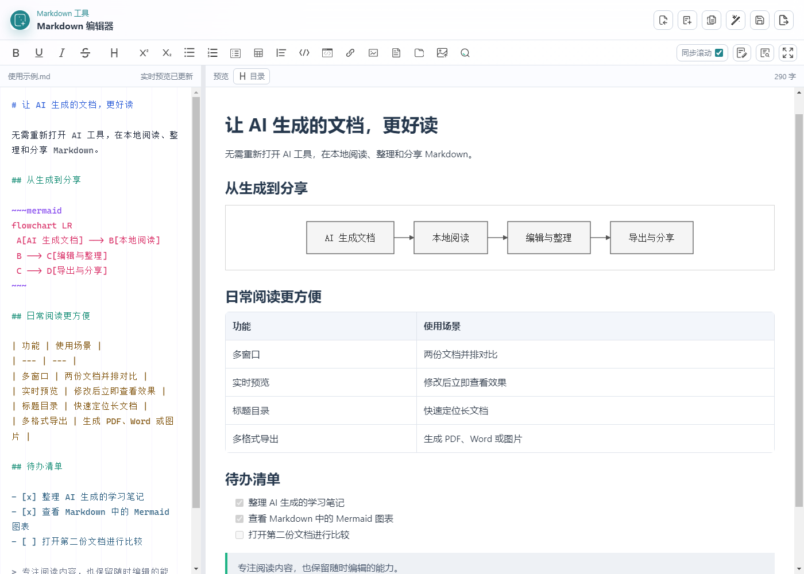
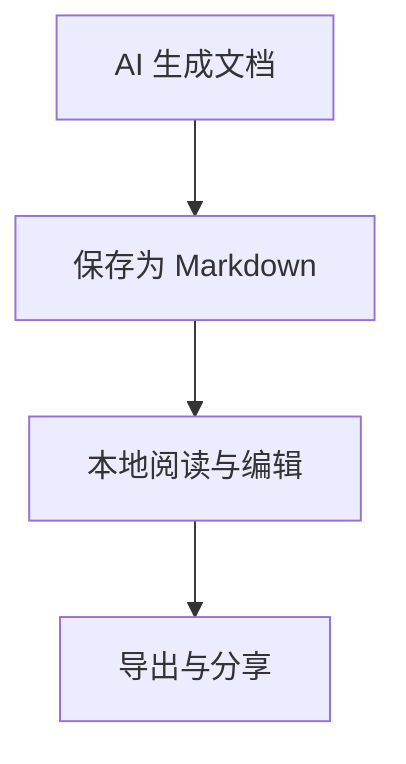

# Markdown 阅读编辑器

**让 AI 生成的 Markdown，离开 AI 工具也好读。**

一个面向 Windows 的 Markdown 桌面阅读与编辑工具。打开本地 `.md` 文件，即可查看排版后的标题、列表、表格、代码和 Mermaid 图表；需要修改时，也可以直接编辑并实时预览。

[下载 v1.0.7](https://github.com/JLS-superme/markdown-reader/releases/tag/v1.0.7) · [版本记录](CHANGELOG.md) · [反馈问题](https://github.com/JLS-superme/markdown-reader/issues)



## 为什么做这个工具

AI 正在生成越来越多的 Markdown 文档：方案、学习笔记、操作步骤、项目说明、会议纪要……但生成之后，我们往往只是想再看一眼内容，并不需要每次都打开 AI 工具。

记事本默认显示的是 Markdown 源码，表格、标题和图表不直观。VS Code 能预览 Markdown，但临时阅读一份文档时，还需要在源码与预览之间操作。对我来说，一个可以直接打开、舒适阅读、顺手修改的独立桌面工具更方便。

这个项目就是为这样的日常使用场景制作的：**把 Markdown 当作文档来阅读，也保留随时编辑的能力。**

## 有哪些好处

| 功能 | 解决什么问题 |
| --- | --- |
| 实时预览 | 左侧编辑，右侧立即看到排版效果；也支持只阅读或只编辑 |
| 多窗口阅读 | 从资源管理器打开另一份 Markdown，会新建窗口，方便并排比较，不覆盖正在编辑的内容 |
| Mermaid 图表 | 支持反引号和波浪号代码围栏，流程图采用灰白配色与直角连线，适合阅读 AI 生成的结构图和流程图 |
| 长文档导航 | 标题目录、同步滚动、预览缩放和全屏，方便阅读较长的说明文档 |
| 常用编辑工具 | 标题、列表、表格、链接、图片、删除线、查找替换，以及一键格式修复 |
| 本地文档跳转 | 按住 Ctrl 单击本地 Markdown 链接，可在新窗口打开关联文档 |
| 多种导出格式 | 可导出 Markdown、HTML、PDF、Word、PNG、JPEG 和 WebP；排版导出正文默认宋体、小四（12pt） |
| 保存保护 | 关闭含有未保存修改的窗口时，会提示保存，减少误关造成的内容丢失 |
| 无需 AI 登录 | 阅读、编辑和导出本地 Markdown 不需要 AI 账号或 API Key |

## 下载和使用

当前提供 **Windows x64** 版本：

- [安装版：Markdown-Editor-Setup-1.0.7.exe](https://github.com/JLS-superme/markdown-reader/releases/download/v1.0.7/Markdown-Editor-Setup-1.0.7.exe)：可选择安装目录，创建桌面和开始菜单快捷方式。
- [免安装版：Markdown-Editor-1.0.7.exe](https://github.com/JLS-superme/markdown-reader/releases/download/v1.0.7/Markdown-Editor-1.0.7.exe)：适合直接运行、随手阅读。

1. 启动软件，将 Markdown 文件拖入窗口，或点击导入按钮。
2. 在预览区阅读文档，必要时切换到编辑与预览并排模式。
3. 想比较两份文档时，再从资源管理器打开另一份 Markdown，即可使用两个窗口。
4. 需要分享文档时，点击导出并选择格式。

安装版会注册 `.md` / `.markdown` 文件关联。如果 Windows 仍使用其他程序打开，可以在“打开方式”中选择本程序。

### Mermaid 写法

反引号围栏与波浪号围栏都可以：

````markdown

````

````markdown
~~~mermaid
flowchart LR
    A[打开文档] --> B[阅读内容]
~~~
````

上例中的 Mermaid 围栏使用三个 `~`；删除线仍使用 `~~需要删除的文字~~`。实际使用时，在图表代码末尾用三个 `~` 关闭围栏。

## 从源码运行

建议在 Windows 上使用 Node.js 22 或 24 LTS，以及 npm。

```bash
git clone https://github.com/JLS-superme/markdown-reader.git
cd markdown-reader
npm ci
npm start
```

普通 Markdown 阅读与编辑不需要 Python。导入外部 DOCX、HTML、PDF 并转换为 Markdown 时，需要额外安装 Python 3.10+ 和转换依赖：

```bash
npm run setup-converter
```

如果 Python 不在 PATH 中，可以通过 `MARKITDOWN_PYTHON` 环境变量指定 Python 可执行文件路径。本程序自己导出的部分文档格式会保留 Markdown 源文，重新导入时优先恢复源文。

### 打包和测试

```bash
npm test
npm run test:diagram
npm run test:windows
npm run build:win
```

安装包和免安装版会输出到 `dist/`。也可以运行 `npm run pack` 生成未压缩的应用目录。首次安装依赖或打包时需要下载依赖；Mermaid 渲染组件随程序分发，日常阅读本地图表无需联网下载。

## 当前边界

- 当前发布和测试的平台为 Windows x64。
- 使用轻量 Markdown 解析实现，并非完整的 CommonMark/GFM 兼容实现；复杂嵌套语法和部分扩展可能存在差异。
- Word 导出主要保留正文、标题、列表和表格，Mermaid 在 Word 中目前按代码文本导出；如需保留图表外观，建议导出 PDF、HTML 或图片。
- 超宽图表导出到 A4 PDF 时会按页宽缩放。普通 Markdown 文件本身不保存字体设置。
- 文档内的远程图片仍可能需要网络连接；一般 PDF 的转换不包含扫描件 OCR。

## 项目结构

```text
main.js                Electron 主进程、文件处理、多窗口和导出
preload.js             桌面能力与页面之间的接口
app.js                 Markdown 编辑、预览和交互
markdown-syntax.js     共享代码围栏解析
styles.css             界面样式
vendor/                随程序分发的 Mermaid 组件
vendor-src/            直角图表布局适配与构建脚本
tests/                 解析、导出、图表和多窗口回归测试
convert_to_markdown.py  可选的文档转换入口
```

## 反馈和贡献

欢迎通过 Issues 提交问题或建议，也欢迎提交 Pull Request。报告排版问题时，请尽量附上最小 Markdown 示例、软件版本和效果截图，并先移除个人或工作敏感内容。

## 开源许可与致谢

项目使用 [MIT 许可证](LICENSE)。第三方组件保留各自许可证，详见 [第三方说明](THIRD_PARTY_NOTICES.md)。

感谢 Electron、Mermaid、ELK、Prettier、docx、pdf-lib、JSZip 和 Microsoft MarkItDown 等开源项目。这个桌面工具最初在 MarkItDown 项目工作目录中开发，现整理为独立仓库；它不是 Microsoft 官方发布的桌面应用。
